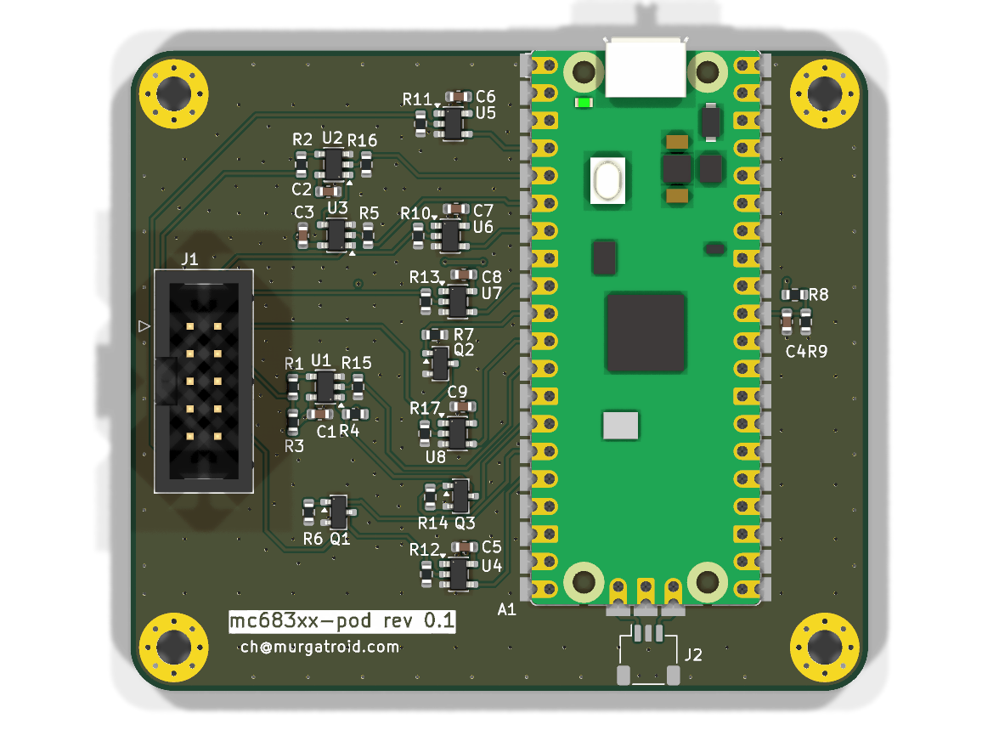

# mc683xx-bdm

A USB background debug mode (BDM) pod for Motorola CPU32
microcontrollers (683xx), such as the MC68331. A Raspberry Pi Pico on a
small carrier board drives the standard 10-pin BDM header through 5 V
level translators. Firmware and host tools are in Rust.




- Reset, halt, run and step the target; read and write its registers
  and memory.
- Debug with gdb: breakpoints, stepping, Ctrl-C.
- Script it from Python, flash programming included.
- Read 512 KB in under 6 seconds.

Proven on an MC68331 from a Linux host; see [docs/status.md](docs/status.md)
for what works, what is untried, and the limits.

## Quickstart

1. Install `bdm`, the udev rule and the firmware, from the
   [APT repository](https://github.com/charlieh0tel/apt-repo)
   (`sudo apt-get install mc683xx-bdm`) or a GitHub Release's `.deb`.
2. Flash the firmware: `bdm bootsel`, then copy
   `/usr/share/mc683xx-bdm/pod-fw-rp2040.uf2` onto the RPI-RP2 drive.
3. Cable the pod to the target's BDM header and power the target.
4. Run `bdm pins`, `bdm reset`, then `bdm regs`.

Don't unplug the pod while its green LED is lit.

## Install

```
sudo apt-get install mc683xx-bdm   # bdm, the udev rule, the UF2
cargo install mc683xx-bdm          # bdm only
pip install mc683xx-bdm            # the Python module mc683xx_bdm
```

Without the Debian package, install the udev rule by hand
([docs/usage.md](docs/usage.md)).

## Documentation

- [docs/usage.md](docs/usage.md): `bdm`, gdb, Python, udev.
- [docs/status.md](docs/status.md): what works, limits, getting a board.
- [docs/development.md](docs/development.md): layout, building, testing.
- [docs/usb-protocol.md](docs/usb-protocol.md): the host-pod protocol.
- [docs/bring-up.md](docs/bring-up.md): checking a new pod.
- [hardware/README.md](hardware/README.md): the carrier's revisions.
- [PLAN.md](PLAN.md): the design and why.

## License

Hardware (`hardware/`): CERN-OHL-S-2.0. Everything else of the
project's own: GPL-3.0-only. `third_party/` documents are their
owners' (`third_party/NOTICE`).
