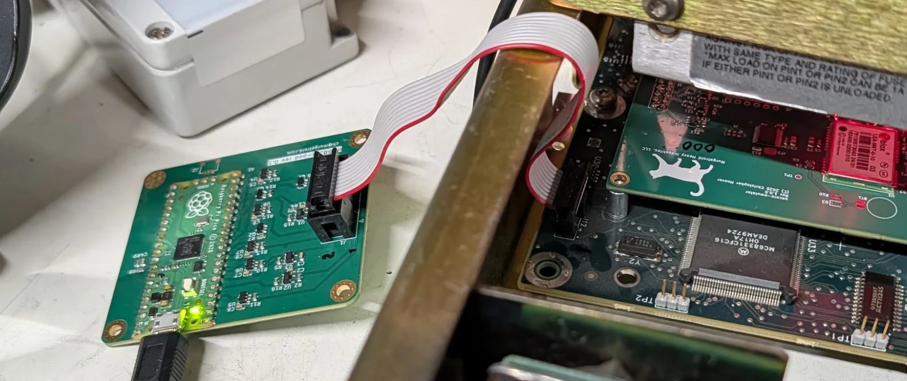

# mc683xx-bdm

A USB background debug mode (BDM) pod for Motorola/Freescale CPU32
(683xx) microcontrollers, primarily the MC68331: a Raspberry Pi Pico or
Pico 2 on a carrier board with 5 V level translators and the standard
10-pin BDM header.  PIO clocks the BDM serial link; firmware and host
are Rust.




## Quickstart

1. Install `bdm`, the udev rule and the firmware: from the APT
   repository (Install), or a GitHub Release's `.deb`:

   ```
   sudo apt install ./mc683xx-bdm_VERSION-1_amd64.deb
   ```

   Or `cargo install mc683xx-bdm`, then the udev rule by hand:
   `sudo cp packaging/udev/70-mc683xx-pod.rules /etc/udev/rules.d/`.

2. Flash the firmware: plug in the pod, put it into its bootloader
   (a blank Pico is there already: skip `bdm bootsel`), and copy the
   UF2 onto the RPI-RP2 drive it mounts:

   ```
   bdm bootsel
   cp /usr/share/mc683xx-bdm/pod-fw-rp2040.uf2 /media/$USER/RPI-RP2/
   ```

   The UF2 is also in each GitHub Release.

3. Cable the pod's J1 to the target's 10-pin BDM header, and power the
   target.

4. Read the pins: FREEZE, RESET and DS levels, and target VDD (about
   5 V).

   ```
   bdm pins
   ```

5. Reset the target into background mode and read its registers:

   ```
   bdm reset
   bdm regs
   ```

## Status

Works, on an MC68331 target: reset into background mode, halt and go,
registers, memory and SIM register reads, a 512 KB flash read, writes,
and gdb (registers, memory, disassembly, breakpoints, continue, step
in RAM and ROM, through TRAP and RTE, in user mode and into an
interrupt, Ctrl-C, detach and kill).

Not yet tried on silicon (`TODO.md`): a flash-programming command
(flash has been programmed with `bdm write` sequences); the Pico 2
(RP2350) build; DSCLK above 4 MHz.

Keep DSCLK (`bdm clock`) at or below about a third of the target's
system clock: the pod samples DSO 15/16 of a bit after each rise, and
the CPU may take up to 2 system clocks, plus about 40 ns of delays, to
put it out (PLAN.md, Protocol summary).  On an 8.39 MHz target that is
3 MHz (`docs/58503a/`); above it the link fails and only `bdm reset`
recovers.  The pod caps DSCLK at 4 MHz whatever the target.

Known limit: a pod restart (a USB replug, say) during `bdm hold` or in
the middle of a request can disturb a halted target until `bdm reset`.
A restart between requests is safe (`docs/bring-up.md`, step 5).  The
fix is planned for the next carrier revision (`hardware/README.md`,
Next revision).

The carrier is rev 0.2 (`hardware/mc683xx-pod/`, 68 x 59 mm, 4
layers); its silkscreen reads rev 0.1 (`hardware/README.md`).

## Getting a board

There is no kit or store.  `hardware/production/20261102-0.2/` holds
the JLCPCB order files for the latest revision (Gerbers and drill,
BOM, placement), assembled with the Pico, J2 (SWD) not fitted;
RELEASING.md, Carrier board, has how a release is made.  The carrier
takes a Pico or a Pico 2; the released UF2 is for the Pico (RP2040),
and a Pico 2 needs its own build (Firmware).

## Install

```
cargo install mc683xx-bdm      # bdm, from crates.io
pip install mc683xx-bdm        # the Python module mc683xx_bdm, from PyPI
sudo apt install ./mc683xx-bdm_VERSION-1_amd64.deb   # from a GitHub Release: bdm, the udev rule, the UF2
```

The Debian package is also in the APT repository at
https://github.com/charlieh0tel/apt-repo (its README sets it up):
`sudo apt-get install mc683xx-bdm`.

`cargo install` and `pip install` carry no udev rule: on Linux without
root, install `packaging/udev/70-mc683xx-pod.rules` (Host).  The pod's
firmware is the release's `pod-fw-rp2040.uf2`, also in the Debian
package; `bdm bootsel` puts the pod into its bootloader for it.

## Layout

| Path | What |
|---|---|
| `PLAN.md` | the design and why it is the way it is |
| `TODO.md` | the work list |
| `RELEASING.md` | cutting a release: firmware, the Debian package, crates.io, PyPI; a board release |
| `docs/` | the host-pod protocol (`usb-protocol.md`), bring-up steps (`bring-up.md`); `oncore-vp/`, notes on the Motorola Oncore VP's BDM test points; `58503a/`, the HP 58503A's BDM header and reading its flash; `images/`, the carrier's render (`make render`) and a photo |
| `hardware/` | the KiCad carrier board, and its revisions (`README.md`); `ee_tooling/`, the shared tooling (a submodule on ee_tooling's `release/0.2` branch), whose `jlcpcb-release` builds a JLCPCB order into `production/`, each release as ordered; `fastcheck.py`, a report on the BDM link's fast nets (`uv run python fastcheck.py mc683xx-pod/mc683xx-pod.kicad_pcb`) |
| `Cargo.toml` | the host Rust workspace: `crates/` |
| `crates/` | `proto/`, `mc683xx-bdm-proto`, shared by the firmware and the host; the host crates: `host/`, `mc683xx-bdm` (library and `bdm` CLI), `py/`, `mc683xx-bdm-py` (Python bindings), `model/`, `mc683xx-bdm-model` (a model CPU32, for tests), `stand-in/`, `mc683xx-bdm-stand-in` (`bdm-stand-in`, a pod on a socket over the model) |
| `firmware/` | `pod-fw`, the pod's firmware, its own workspace (Pico targets) |
| `packaging/` | the Debian changelog and the pod's udev rule |
| `scripts/` | `published-crates.sh`, the crates crates.io already has at this version (RELEASING.md) |
| `third_party/` | vendor documents and their provenance (`NOTICE`) |

## Firmware

```
cargo test                     # every crate in crates/, on the host

cd firmware/pod-fw
cargo run --release            # Pico, defmt over RTT, through an SWD probe
cargo build --release --no-default-features -F rp2040   # production
cargo build --release --no-default-features -F rp235xa \
    --target thumbv8m.main-none-eabihf                   # Pico 2

cd ../..
make lint                      # clippy on every build, before each commit
make size                      # every firmware build linked; flash and RAM
```

## Host

```
cargo run -p mc683xx-bdm --bin bdm -- pins     # or halt, regs, dump 0xfffa00 64, ...
cargo run -p mc683xx-bdm --bin bdm -- --pod unix:/path/to/socket regs   # a stand-in pod
cargo run -p mc683xx-bdm --bin bdm -- list     # each pod on USB: serial number, bus-ports
cargo run -p mc683xx-bdm --bin bdm -- --pod usb:E6613852833B2A2F regs    # one pod of several

cargo run -p mc683xx-bdm-stand-in -- unix:/tmp/pod.sock &      # a pod on a model CPU32
cargo run -p mc683xx-bdm --bin bdm -- --pod unix:/tmp/pod.sock reset
```

`--pod usb`, the default, is the only pod connected; with more than
one, `bdm` lists their serial numbers and stops.  `--pod usb:SERIAL`
picks one by the serial number `bdm list` shows (the Pico's unique ID,
as picotool shows it; case ignored), for `bdm bootsel` too.  `bdm list`
does not open the pods, so it needs no udev rule, and takes no `--pod`.

gdb on the target: `bdm gdb --scratch ADDRESS` listens on
127.0.0.1:1234 (`--listen HOST:PORT` for another) for one session;
then, in an m68k gdb (`gdb-multiarch`):

```
set architecture m68k:cpu32
set endian big
target remote localhost:1234
```

Without an executable, gdb does not know the CPU32 is big-endian and
shows every register and word byte-reversed.  `--scratch` names 1026 bytes of RAM, even, that the
program does not use: a step's exception table and BGND stub.
Breakpoints are BGND written into memory, so RAM only.  Detach leaves
the target running, kill leaves it halted.  Ctrl-C in gdb halts the
target for gdb; Ctrl-C (SIGINT) or SIGTERM to `bdm` ends the session:
gdb's breakpoints removed, the target halted, SFC and DFC put back, and
exit status 130 or 143.  A second signal meanwhile exits at once,
breakpoints or not.

Without root on Linux, the pod needs the udev rule
`packaging/udev/70-mc683xx-pod.rules`: copy it into
`/etc/udev/rules.d/`, or install the Debian package, which carries it.
It gives the pod to the user at the machine's seat (`TAG+="uaccess"`)
and to group `plugdev`, mode 0660, since uaccess does nothing for a
login over ssh: add a remote user with `sudo adduser USER plugdev`.
Replug the pod after installing the rule.  1209:0001 is pid.codes'
shared test pair, so the rule also matches anything else using it.

### Python

`crates/py` is the Python module `mc683xx_bdm`, PyO3 bindings
over `mc683xx-bdm`: one open pod across calls, for scripts with loops and
polling.  uv builds it with maturin into the crate's `.venv`:

```
cd crates/py
uv sync                        # builds and installs the module
uv run pytest                  # against bdm-stand-in, no hardware
uv build --wheel               # a wheel, to pip install elsewhere
```

```python
import time
import mc683xx_bdm

with mc683xx_bdm.Pod("usb") as pod:  # or "usb:SERIAL", "unix:/tmp/pod.sock"
    print(pod.reset_with_breakpoint())      # breakpoint
    pod.write_register("PC", 0x100000)
    pod.write_memory(0x100000, bytes.fromhex("4e714afa"), size=2)
    pod.go()
    while pod.background is None:           # poll until it halts
        time.sleep(0.01)
    print(pod.registers())
    print(hex(pod.bus_read(0xFFFA00, 2)))   # SIMCR
```

The names follow the emulator's bindings (`mc683xx`, in m683xx-emu's
`crates/cpu32-py`): `halt`, `go`, `reset_with_breakpoint`, `background`,
`read_register("D0")`, `registers()`, `bus_read(address, size,
function_code=5)`, `Entry`, `BusError`, `TargetError`.  Blocks are
`read_memory(address, length, *, size=1, function_code=5)` and
`write_memory(address, data, ...)`; `pins`, `version`, `hello`,
`set_clock`, `get_clock`, `resync`, `call`, `reset` (to run) and `transfer` are the
pod's own.  Open it with `with mc683xx_bdm.Pod(...) as pod:`: leaving
the block, or `close()`, puts back the program's SFC and DFC, as `bdm`
does.  A Pod collected unclosed does the same, best effort, and issues
a `ResourceWarning`, as Python's files do.  Exceptions: `TransportError`
(an `OSError`), `ProtocolError`, `TargetError`, `BusError`, and
`ValueError` for a bad name, size or function code.  Types:
`python/mc683xx_bdm/__init__.pyi`, which `make lint` checks against the
module with mypy's stubtest.

`serve_gdb` serves one gdb session over the open pod, as `bdm gdb`
does, after a script has set the target up (chip selects, say), and
returns `Ending.DETACHED` (running) or `Ending.KILLED` (halted):

```python
with mc683xx_bdm.Pod("usb") as pod:
    pod.reset_with_breakpoint()
    ...                                     # the board's own setup
    ending = pod.serve_gdb("127.0.0.1:1234", ready=print, scratch=0x100800)
```

`scratch` is required, as `bdm gdb --scratch`; the address defaults to
127.0.0.1:1234 and `ready(port)` is called once it listens.  It blocks
with the GIL released; Ctrl-C (`KeyboardInterrupt`, or any signal
handler's exception) ends the session, gdb's breakpoints removed and
the target halted, and is raised; if removing them or halting fails,
that failure is its `__cause__`.  Python leaves SIGTERM to its
default, which ends the process with nothing removed: a script that
may get one installs a handler that raises.

### Debian package

`make deb` builds `mc683xx-bdm`: `bdm`, the udev rule and the pod's
firmware (`/usr/share/mc683xx-bdm/pod-fw-rp2040.uf2`, built with
picotool 2, else elf2uf2-rs), with
cargo-deb 3.8.0 (deb-workflows' `rust-build-deb` pin):
`target/debian/mc683xx-bdm_VERSION-1_ARCH.deb`.  Metadata:
`[package.metadata.deb]` in `crates/host/Cargo.toml`; changelog:
`packaging/debian/changelog`.  Released from a `v*` tag by
`.github/workflows/release.yml` (RELEASING.md).

## License

- Hardware: CERN-OHL-S-2.0 (`hardware/LICENSE`): the KiCad designs in
  `hardware/` and the release packages in `hardware/production/`.
- Everything else of the project's own, firmware and documentation:
  GPL-3.0-only (`LICENSE`).
- The documents in `third_party/` are their owners' and not covered
  (`third_party/NOTICE`).

## Contributing

Once per clone: `git submodule update --init` (ee_tooling, which the
commit hook runs from), then `make hooks`.  For the hardware tools,
`cd hardware && uv venv --system-site-packages --python /usr/bin/python3
&& uv sync`.  `AGENTS.md` has the rules.
